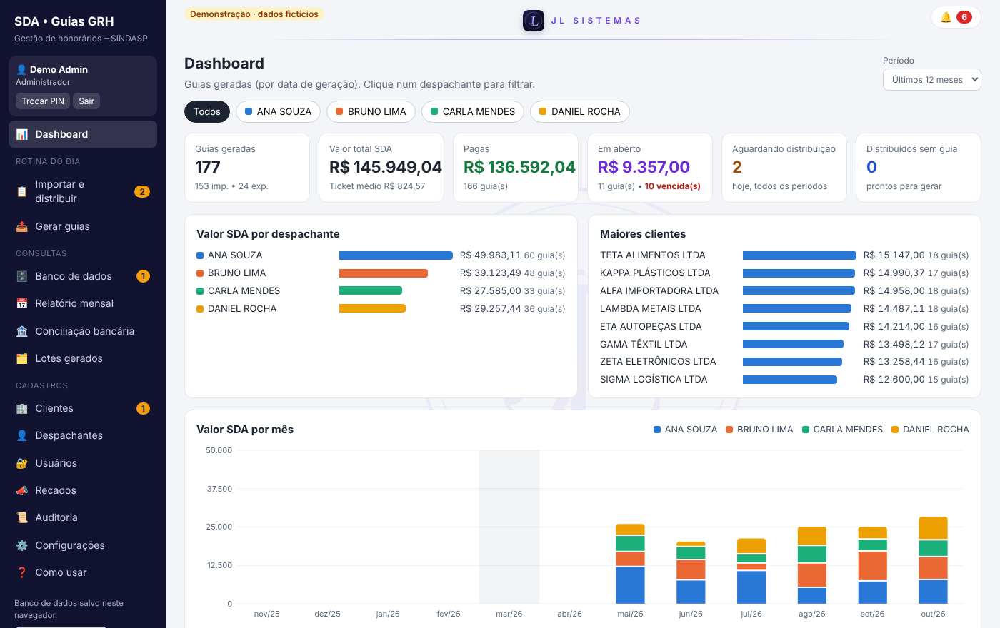
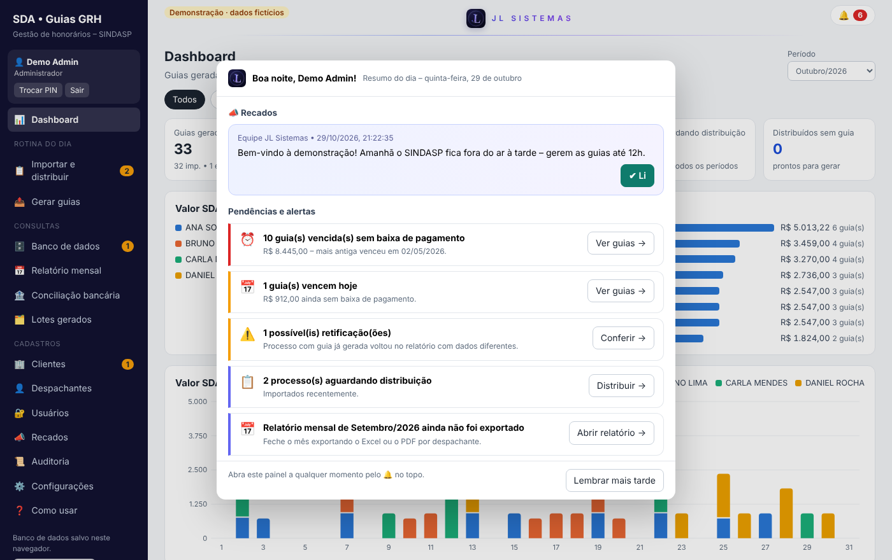
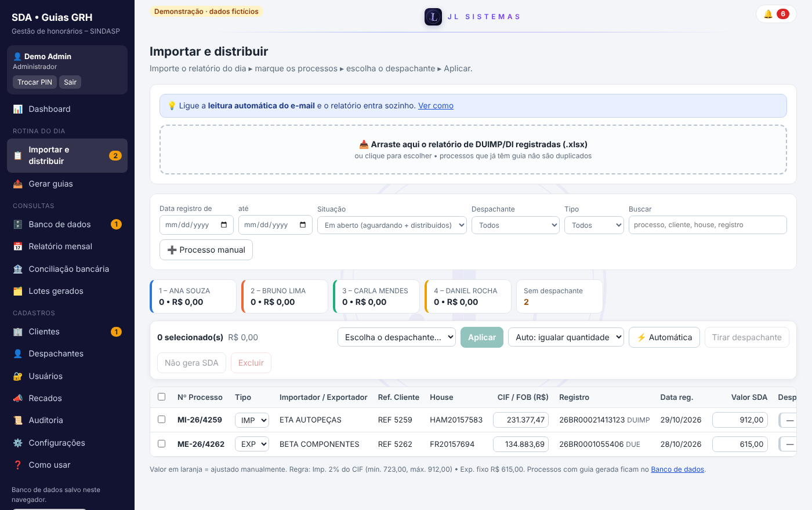
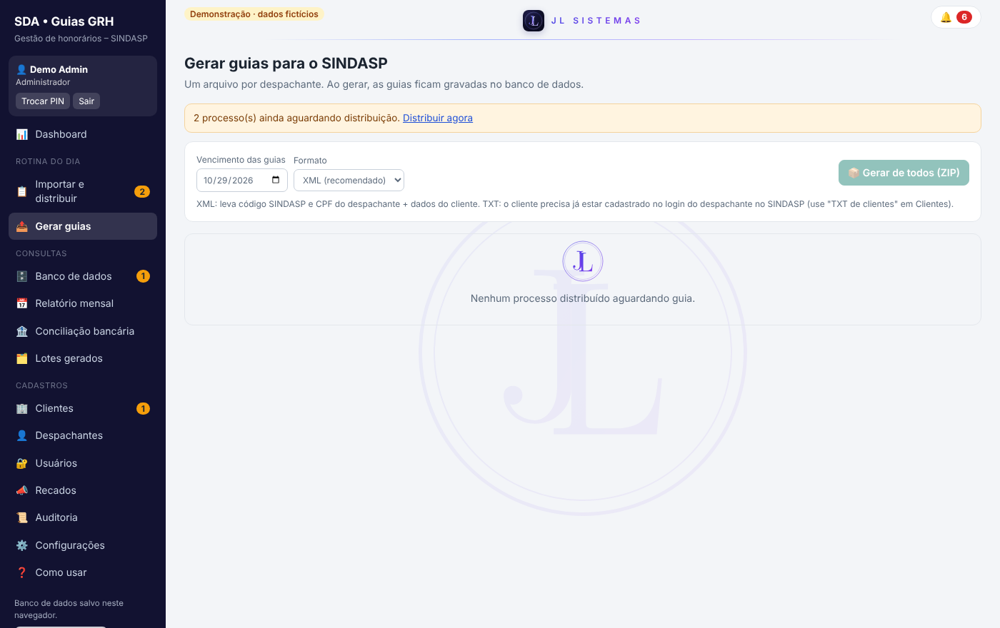
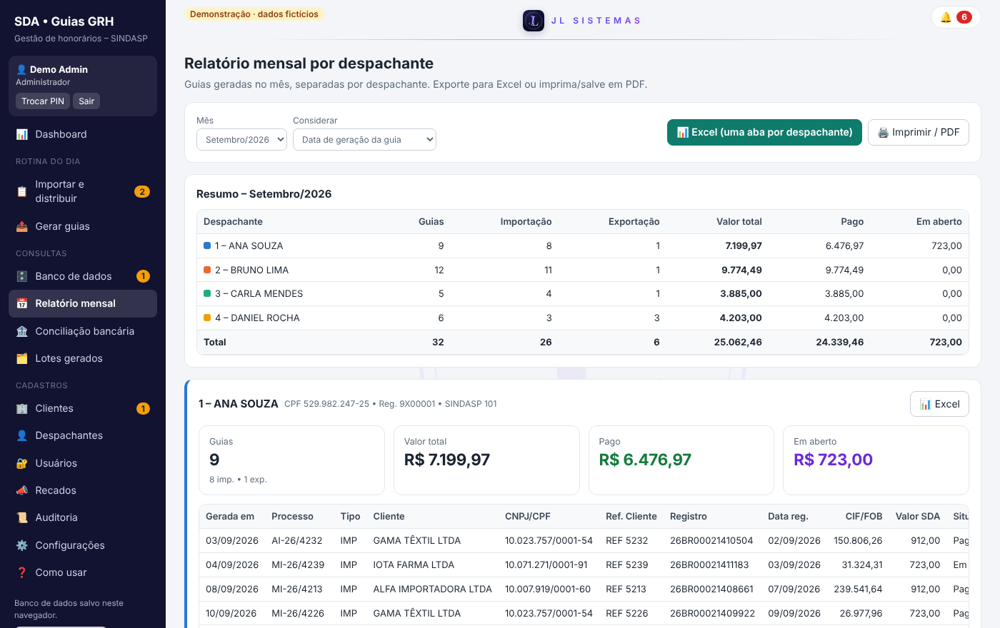
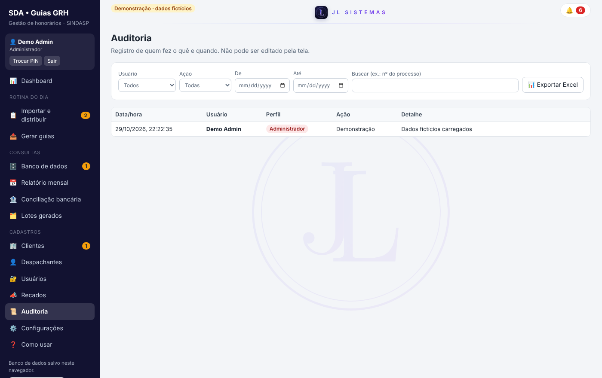
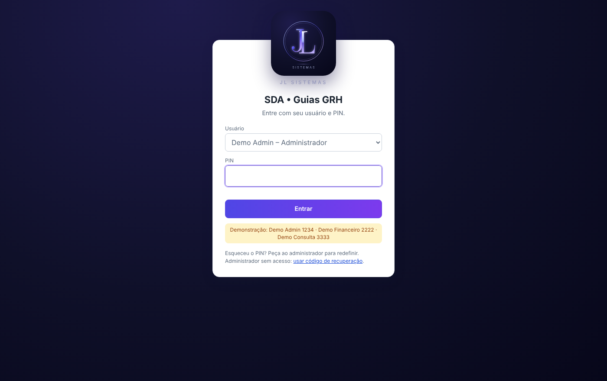

<h1 align="center">SDA • Guias GRH</h1>

<b>Automação do pagamento de honorários (SDA) de despachantes aduaneiros</b> 
da planilha recebida por e-mail até a guia pronta para o sindicato – com controle, auditoria e relatórios.

<a href="https://jefflino7.github.io/sistema-guias-sda/"><b>▶ Testar a demonstração online</b></a> ·
<a href="#funcionalidades">Funcionalidades</a> ·
<a href="#tecnologia">Tecnologia</a> ·
<a href="#sobre-o-autor">Autor</a>

> ℹ️ **Versão de demonstração.** Todos os nomes, CNPJs, CPFs e valores são **fictícios**. O sistema original é usado internamente no departamento financeiro de uma empresa de despacho aduaneiro.

---

## O problema

Em comércio exterior, cada declaração registrada (**DUIMP/DI** na importação, **DUE** na exportação) gera o recolhimento de honorários ao sindicato dos despachantes por meio de uma guia (**GRH**). No dia a dia, o financeiro:

- recebia por e-mail uma planilha com as declarações do dia anterior;
- calculava o valor de cada guia à mão (2% sobre o valor aduaneiro, com mínimo e máximo);
- decidia em qual despachante cada guia seria emitida;
- digitava os dados no site do sindicato, um a um;
- controlava pagamentos e fechamento do mês em planilhas separadas.

Trabalho repetitivo, sujeito a erro de digitação e sem rastreabilidade de quem fez o quê.

## A solução

Um sistema web que roda no próprio navegador, sem instalação e sem servidor, compartilhado pela equipe através de uma pasta na nuvem:

**Planilha do e-mail ➜ cálculo automático ➜ distribuição ➜ arquivo XML/TXT no padrão do sindicato ➜ baixa de pagamento ➜ relatório mensal**

## Funcionalidades

| | |
|---|---|
| 📥 **Importação** do relatório diário (manual ou lendo uma pasta onde o Outlook salva o anexo) | 🧮 **Cálculo automático** com regras configuráveis (percentual, mínimo, máximo, valor fixo) |
| 👥 **Distribuição** entre despachantes – manual ou automática, equilibrando quantidade ou valor | 📤 **Geração de arquivos** XML e TXT no layout oficial de integração, um por despachante |
| 💰 **Controle de pagamentos** e **conciliação bancária** por extrato OFX/CSV | 📊 **Dashboard interativo** com filtros por período e por despachante |
| 📅 **Relatório mensal** por despachante em Excel (uma aba cada) ou PDF | 🔐 **Login com PIN** e perfis (Administrador, Financeiro, Consulta) |
| 📜 **Auditoria** completa – quem importou, distribuiu, gerou ou pagou | 🔔 **Resumo do dia** ao entrar: guias vencidas, pendências, recados da gestão |

### Telas

| Resumo do dia ao entrar | Distribuição |
|---|---|
|  |  |
| **Geração das guias** | **Relatório mensal** |
|  |  |
| **Auditoria** | **Login** |
|  |  |

## Tecnologia

- **HTML + JavaScript puro** em um único arquivo – abre direto no navegador, sem instalar nada
- **IndexedDB** + **File System Access API**: banco de dados local sincronizado com um arquivo JSON em pasta compartilhada (Dropbox/OneDrive)
- **Sincronização multiusuário** com versão por registro, "lápides" para exclusões e junção automática de alterações simultâneas
- **Web Crypto (PBKDF2)** para os PINs, bloqueio por inatividade e trilha de auditoria
- **SheetJS** (leitura/gravação de Excel) e **JSZip**
- **Gráficos em SVG** desenhados sem biblioteca, com paleta validada para daltonismo
- Geração de **XML/TXT** seguindo o XSD de integração do sindicato

### Decisões de projeto

- **Sem servidor de propósito:** a equipe já usava uma pasta compartilhada; o sistema aproveita isso e não gera custo de hospedagem.
- **Dados ficam com a empresa:** nada sai do computador além do arquivo na pasta da própria empresa.
- **Simples para quem usa:** fluxo em 3 passos (importar ➜ distribuir ➜ gerar) e avisos que levam direto à tela onde se resolve.

## Como testar

1. Acesse a **[demonstração online](https://jefflino7.github.io/sistema-guias-sda/)** (ou baixe o `index.html` e abra no Chrome/Edge).
2. Clique em **▶ Entrar na demonstração** – são carregados 6 meses de dados fictícios.
3. Usuários de teste: **Demo Admin** (PIN `1234`), **Demo Financeiro** (`2222`), **Demo Consulta** (`3333`).

Os dados da demonstração ficam apenas no seu navegador.

## Sobre o autor

**Jefferson Lino** – analista de importação, despachante aduaneiro e criador da **JL Sistemas**. Uno a experiência prática em comércio exterior (DUIMP, Catálogo de Produtos, LPCO) com tecnologia para automatizar rotinas reais do setor.

Projeto desenvolvido com apoio de inteligência artificial (Claude) na programação, a partir da análise do processo, das regras de negócio e dos testes feitos por mim no ambiente real.

---

 © JL Sistemas · Jefferson Lino · Todos os direitos reservados

